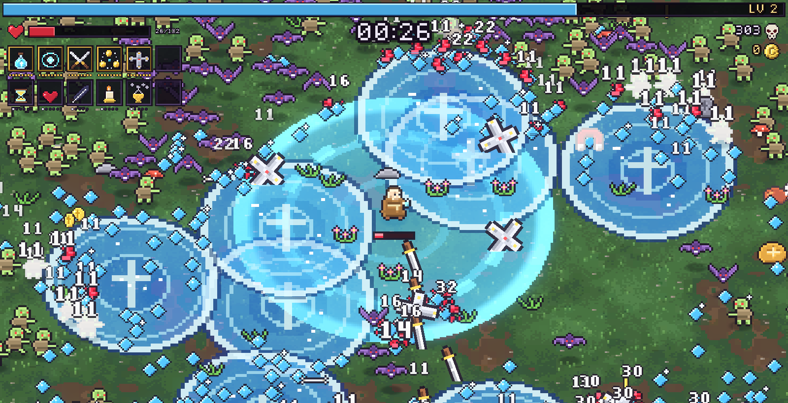
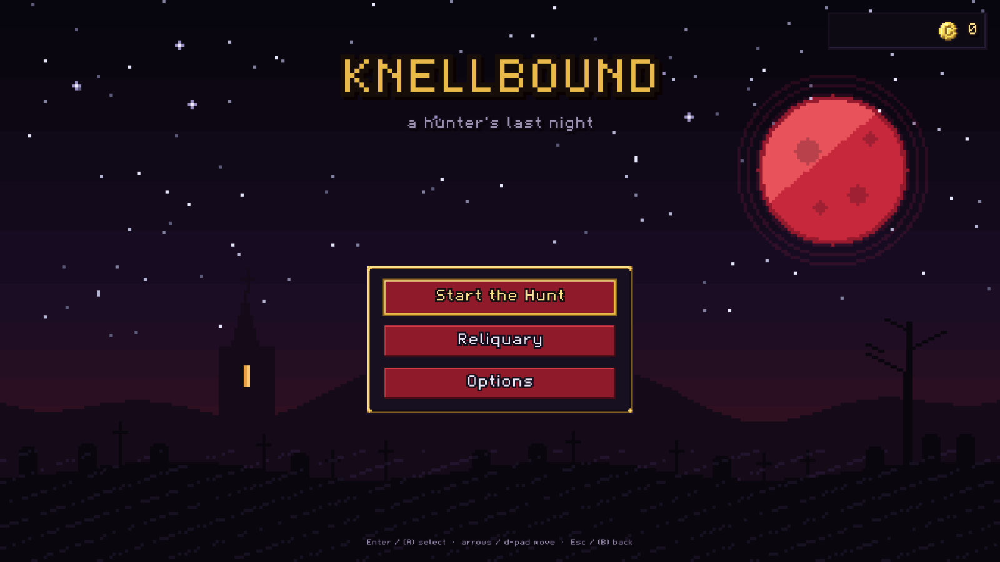
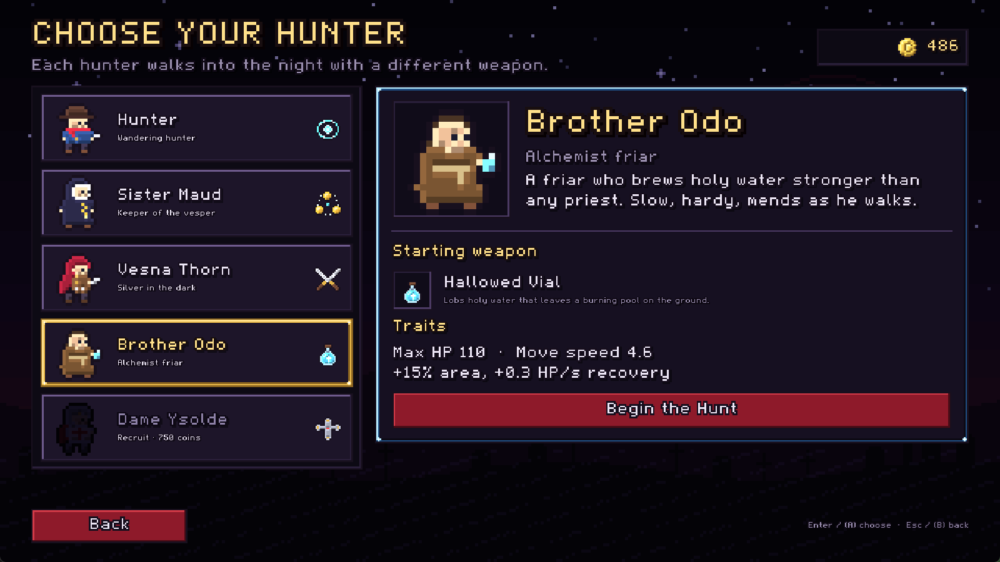
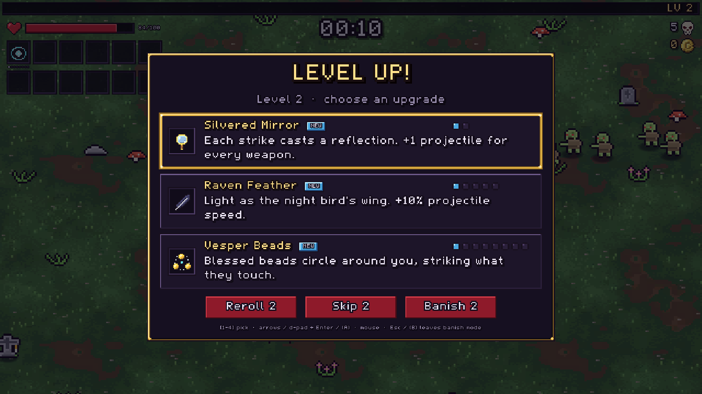

# Knellbound

*A hunter's last night.*

Knellbound is a gothic 2.5D survivors-like made in Godot 4. Pick a hunter, walk into a graveyard full of the dead, and hold out against the horde with relics, prayers and silver. Weapons fire on their own; you move, collect experience, and choose what to grow into.

**[Play in your browser](https://mgalihpp.github.io/knellbound-web/)**



## Features

- **5 hunters**, each with a starting weapon and their own traits: the Hunter, Sister Maud, Vesna Thorn, Brother Odo and Dame Ysolde.
- **10 weapons and 13 passives.** Pair the right ones and a weapon evolves, for example the Holy Aura into Seraph's Halo or the Vesper Beads into the Eternal Rosary.
- **10 enemy types**, plus elites and bosses such as the Hollow Abbot and the Vesperine, and the Knellwraith at the end of the night.
- **Hundreds of enemies on screen at once.** Enemies, projectiles, gems and damage numbers are drawn with MultiMesh and run on packed arrays.
- **The Reliquary**, a permanent shop: coins from each run buy upgrades that carry over to the next one.
- Chests, breakables, pickups, rerolls, skips and banishes.
- Keyboard, mouse and gamepad.

| | |
|---|---|
|  |  |
|  | |

## Controls

| Action | Keyboard | Gamepad |
|---|---|---|
| Move | WASD or arrow keys | D-pad / left stick |
| Select | Enter | A |
| Back | Esc | B |
| Pause | Esc or P | Start |
| Pick an upgrade on level-up | 1 to 4, or arrows and Enter | D-pad and A |

## Running it

1. Install [Godot 4.7](https://godotengine.org/download).
2. Clone this repository and open `project.godot` in Godot.
3. Press F5.

Debug builds add a stats panel and cheat keys (F1 to F7 and others). Press H in a run to show the list.

### Web build

The project ships with a `Web` export preset (single-threaded, so it runs on static hosting such as GitHub Pages without special headers). With the Godot web export templates installed:

```bash
godot --headless --path . --export-release "Web" build/web/index.html
```

In the browser Godot uses the Compatibility renderer (WebGL 2) instead of Forward+.

## Project layout

The architecture notes are in [ARCHITECTURE.md](ARCHITECTURE.md). In short:

- Gameplay runs on a 2D plane; 3D nodes are only for display.
- All update order lives in `core/game.gd`. Systems expose `tick()` instead of their own `_process`.
- Collision uses a spatial hash rebuilt every frame.
- Content (hunters, enemies, weapons, passives, waves, drops, shop upgrades) is data in `data/` as `.tres` resources.
- Sprites and sound effects are generated by the scripts in `tools/`.
